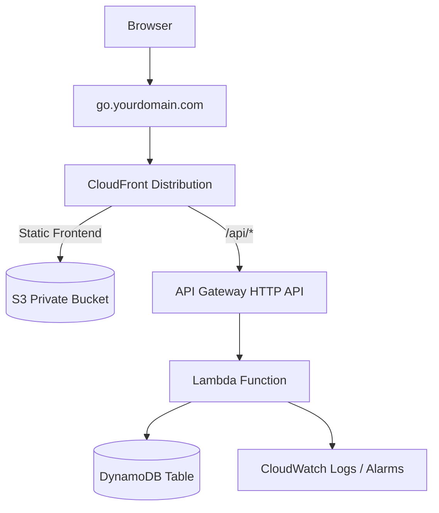

# Serverless URL Shortener on AWS

A serverless web app for creating short URLs. CloudFront securely (HTTPS) and quickly (CDN) serves the static frontend from a private S3 Bucket. API calls are made through API Gateway and served by Lambda function(s), providing a robust and secure backend, while DynamoDB stores records of links.



## Architecture

- **CloudFront** delivers the frontend and routes API requests.
- **S3** stores the static frontend privately.
- **API Gateway** exposes application endpoints.
- **Lambda** creates, retrieves, and redirects short URLs and tracks click counts.
- **DynamoDB** stores short codes, destination URLs, expiration, and click counts.
- **CloudWatch** stores logs and monitors Lambda errors.
- **AWS Budgets** sends an alert at 80% of a $5 monthly budget.

## Features

- Create a short URL from a valid `http://` or `https://` link
- Redirect short codes with HTTP `302`
- List recently created links
- Count clicks
- Expire links automatically using DynamoDB TTL
- HTTPS through CloudFront
- Custom domain pointing to CloudFront

## API Endpoints

| Method | Endpoint                 | Purpose                         |
| ------ | ------------------------ | ------------------------------- |
| `POST` | `/api/links`             | Create a short link             |
| `GET`  | `/api/links`             | List links                      |
| `GET`  | `/api/links/{shortCode}` | View link’s metadata            |
| `GET`  | `/{shortCode}`           | Redirect to the destination URL |

Example request:

```bash
curl -X POST "\$API\_URL/api/links" \\
  -H "Content-Type: application/json" \\
  -d '{"url":"https://example.com","expiresInDays":7}'
```
